# Post-contenido — Manejo de Pantalla y Teclado: Programación en NASM sobre DOSBox

**Asignatura:** Arquitectura de Computadores (UFPS) · **Unidad 7** · Post-contenido

**Estudiante:** Diego Alferez

**Repositorio:** `Alferez-post7-u7` (único para las dos partes)

Este repositorio reúne el laboratorio guiado de la Unidad 7. El estudiante implementó en ensamblador x86 (NASM, formato `bin`, programas `.COM`) nueve programas que se ejecutaron en DOSBox 0.74-3: cuatro de salida de texto y control de pantalla (Parte 1) y cinco de lectura de teclado y acceso directo a la memoria de video (Parte 2).

## Estructura del repositorio

| Archivo | Parte / Paso | Qué hace |
|---|---|---|
| `post1.asm` / `post1.com` | P1 · Paso 1 | Imprime tres líneas con INT 21h / AH=09h |
| `post1b.asm` / `post1b.com` | P1 · Paso 2 | Limpia la pantalla, posiciona el cursor y escribe con color (INT 10h) |
| `post1c.asm` / `post1c.com` | P1 · Paso 3 | Dibuja una cadena carácter por carácter en una posición exacta y con color |
| `post1d.asm` / `post1d.com` | P1 · Paso 4 | Consulta el modo de video (AH=0Fh) y relee una celda (AH=08h) |
| `post2a.asm` / `post2a.com` | P2 · Paso 1 | Lee teclas con INT 16h y muestra scan code y ASCII en hexadecimal |
| `post2b.asm` / `post2b.com` | P2 · Paso 2 | Escribe caracteres directamente en B800h |
| `post2c.asm` / `post2c.com` | P2 · Paso 3 | Rellena la pantalla con `REP STOSW` y centra un mensaje |
| `post2d.asm` / `post2d.com` | P2 · Paso 4 | Mini editor de una línea: INT 16h + B800h |
| `post2e.asm` / `post2e.com` | P2 · Paso 5 | Refleja en tiempo real el estado de Shift y Ctrl (INT 16h / AH=02h) |
| `capturas/` | — | Evidencia de compilación y ejecución de cada checkpoint |

## Cómo compilar y ejecutar

Dentro de DOSBox, con la carpeta del repositorio montada como unidad `C:` y NASM disponible en el `PATH`:

```
C:\> nasm -f bin post1.asm -o post1.com
C:\> post1.com
```

El mismo procedimiento se aplica a los nueve programas (`post1b`, `post1c`, `post1d`, `post2a` … `post2e`).

---

# Parte 1 — INT 21h e INT 10h: salida de texto y control de pantalla

## Interrupciones utilizadas

### INT 21h (servicios del DOS)

| Función | Registros | Uso en el laboratorio |
|---|---|---|
| `AH=09h` | `DS:DX` → cadena terminada en `$` | Imprimir cadenas completas (`post1`, mensajes de `post1d`) |
| `AH=02h` | `DL` = carácter | Imprimir un dígito hexadecimal (`impHex`) |
| `AH=07h` | retorna `AL` | Esperar una tecla sin eco antes de salir |
| `AH=4Ch` | `AL` = código de retorno | Terminar el programa |

### INT 10h (servicios de video del BIOS)

| Función | Registros | Uso en el laboratorio |
|---|---|---|
| `AH=06h` | `AL`=0 limpia, `BH`=atributo de relleno, `CX`=esquina sup. izq., `DX`=esquina inf. der. (`184Fh`) | Limpiar la pantalla |
| `AH=02h` | `BH`=página, `DH`=fila, `DL`=columna | Posicionar el cursor |
| `AH=09h` | `AL`=carácter, `BH`=página, `BL`=atributo, `CX`=repeticiones | Escribir un carácter con color (no avanza el cursor) |
| `AH=0Fh` | retorna `AL`=modo, `AH`=columnas, `BH`=página activa | Verificar el modo de video (`post1d`) |
| `AH=08h` | `BH`=página; retorna `AL`=carácter, `AH`=atributo | Releer la celda bajo el cursor (`post1d`) |

### Byte de atributo

El atributo ocupa 8 bits: `[fondo (4 bits)][texto (4 bits)]`. Por ejemplo, `1Eh` = `0001 1110b` es fondo azul (1) con texto amarillo (Eh), y `2Fh` es fondo verde (2) con texto blanco brillante (Fh). En el código estos valores se definen como constantes (`ATTR_AMARILLO_SOBRE_AZUL`, `ATTR_PRUEBA`, …) en lugar de usar números sueltos.

## Descripción de los programas

- **`post1.asm`** imprime tres cadenas con una única función (`AH=09h`); `AH` se conserva entre llamadas y solo cambia `DX`.
- **`post1b.asm`** limpia la pantalla con `AH=06h`, posiciona el cursor con `AH=02h` y escribe `A` (amarillo sobre azul) y `U7` (rojo claro). Como `AH=09h` no mueve el cursor, la columna se avanza a mano.
- **`post1c.asm`** recorre `"UNIDAD 7 - PANTALLA Y TECLADO"` con `SI`; en cada iteración posiciona el cursor en `(DH, DL)`, escribe el carácter en verde brillante, e incrementa `SI` y `DL`. Queda centrado en la fila 5, columna 25.
- **`post1d.asm`** limpia la pantalla, consulta el modo con `AH=0Fh` y lo imprime en hexadecimal; escribe `Z` con atributo `2Fh` en la fila 8, columna 10, reposiciona el cursor en esa misma celda, la relee con `AH=08h` y compara carácter y atributo con lo escrito.

---

# Parte 2 — INT 16h y acceso directo a B800h

## INT 16h (teclado del BIOS)

| Función | Resultado | Uso |
|---|---|---|
| `AH=00h` | Bloquea hasta que haya tecla. `AH`=scan code, `AL`=ASCII (0 si es extendida) | `post2a`, `post2d`, consumo de tecla en `post2e` |
| `AH=01h` | No bloquea. `ZF=1` si no hay tecla, `ZF=0` si hay (no la consume) | Sondeo en `post2e` |
| `AH=02h` | No bloquea. `AL` = byte de estado de teclado (`0040h:0017h`) | Estado de Shift/Ctrl en `post2e` |

Scan codes usados: Esc = `01h`, Enter = `1Ch`; ASCII de Enter = `0Dh`. Las teclas extendidas (cursores, F1–F12) devuelven `AL=00h`, y el scan code en `AH` identifica la tecla.

## Acceso directo a la memoria de video (B800h)

En modo texto 80×25 a color, la pantalla está mapeada en el segmento `B800h`. Cada celda ocupa dos bytes consecutivos: el **carácter ASCII** (byte par) y el **atributo** (byte impar, `[fondo][texto]`). El offset de una celda es:

```
offset = (fila * 80 + columna) * 2
```

Ejemplo: fila 10, columna 35 → `(10*80 + 35)*2 = 1670`; el carácter queda en `B800h:0686h` y el atributo en `B800h:0687h`. En el código se usa la macro `VIDEO_OFFSET(f, c)` y las constantes `VIDEO_SEG`, `COLUMNAS` y `FILAS`.

Con `AX = (atributo << 8) | carácter`, `REP STOSW` con `CX = 2000` rellena las 80×25 celdas en una sola instrucción (`post2c`, y la limpieza inicial de `post2d` y `post2e`).

## Byte de estado de teclado (INT 16h / AH=02h)

| Bit | 7 | 6 | 5 | 4 | 3 | 2 | 1 | 0 |
|---|---|---|---|---|---|---|---|---|
| Significado | Insert | CapsLock | NumLock | ScrollLock | Alt | **Ctrl** | **Shift izq.** | **Shift der.** |

`post2e.asm` aísla los bits con `test bl, MASK_SHIFT` (`03h`, bits 0 y 1) y `test bl, MASK_CTRL` (`04h`, bit 2) y escribe `1` o `0` en B800h, en la fila 0: `SHIFT:` ocupa las columnas 0–5 con el dígito en la columna 6 (offset 12), y `CTRL:` ocupa las columnas 8–12 con el dígito en la columna 13 (offset 26).

## Arquitectura general de la solución

Los programas son independientes y comparten un mismo esquema: constantes al inicio (segmento de video, atributos, posiciones, máscaras), sección `.data` con las cadenas y variables, y sección `.text` con el código. La Parte 1 usa servicios del sistema (INT 21h) y del BIOS de video (INT 10h); la Parte 2 sustituye INT 10h por escritura directa en `B800h` (más rápida) y añade la entrada por INT 16h. `post2d` combina ambas técnicas (lectura por INT 16h, escritura por B800h) y `post2e` combina el sondeo no bloqueante de INT 16h con la escritura directa en video.

---

# Ajustes sobre el código base de la guía

Al compilar y revisar los programas, el estudiante corrigió los siguientes puntos para que cada checkpoint se cumpla tal como se describe:

| Programa | Problema en el código base | Corrección |
|---|---|---|
| `post1d` | `mov dl, al` guardaba el modo en `DL`, pero la instrucción siguiente `mov dx, msgModo` lo sobrescribía; la comparación con `03h` fallaba siempre | El modo se guarda en la variable `modoActual` y se compara desde memoria; además se imprime en hexadecimal |
| `post2c` | El mensaje usaba atributo `0Fh` (fondo negro), no blanco brillante sobre azul | Se usa `1Fh` y se centra en la columna 32 (mensaje de 16 caracteres) |
| `post2d` | Leía el teclado dos veces por carácter (el carácter solo aparecía con la segunda pulsación) y `AX` se perdía con `imul` | Una sola lectura; el carácter se guarda en `BL` antes de calcular el offset |
| Todos | Valores numéricos sueltos | Constantes y macro `VIDEO_OFFSET`; comentarios en español |

---

# Evidencia (capturas)

Cada checkpoint tiene una captura de la compilación y otra de la ejecución en DOSBox. Los checkpoints de decisiones técnicas se evidencian con capturas de la decisión correspondiente dentro de este README.

| Checkpoint | Compilación | Ejecución |
|---|---|---|
| P1 · CP1 `post1` | 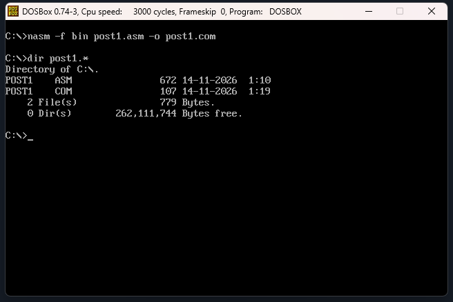 | 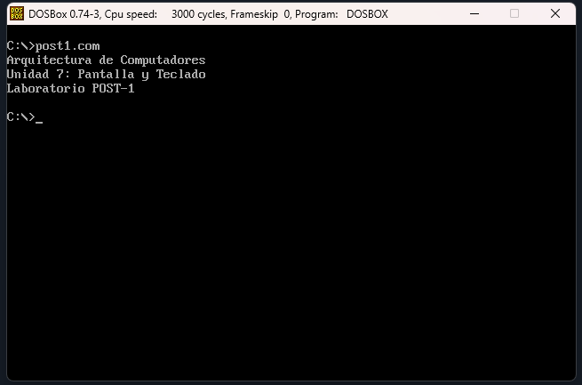 |
| P1 · CP2 `post1b` | 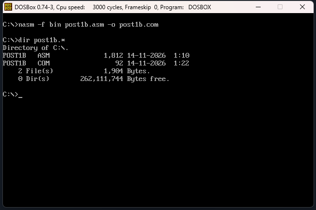 | 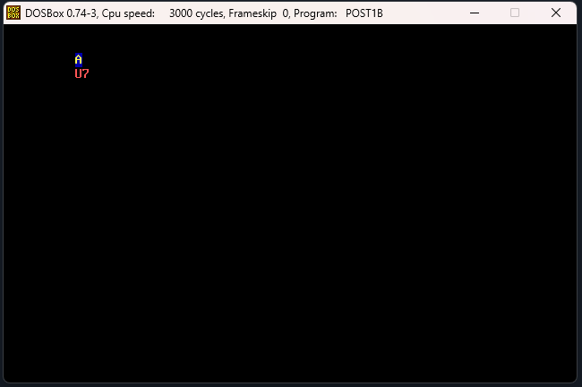 |
| P1 · CP3 `post1c` | 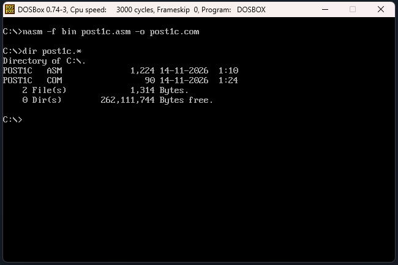 | 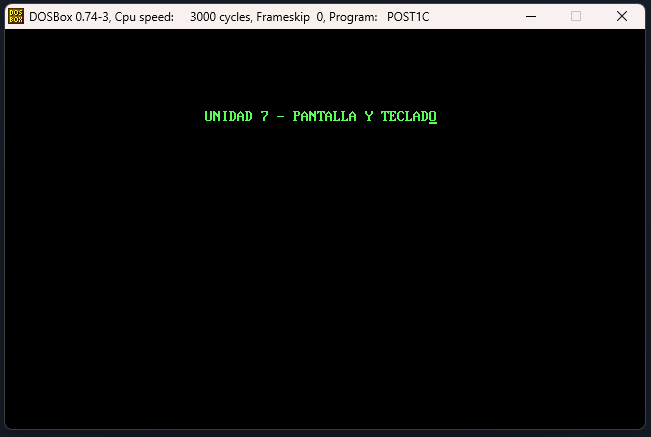 |
| P1 · CP4 `post1d` | 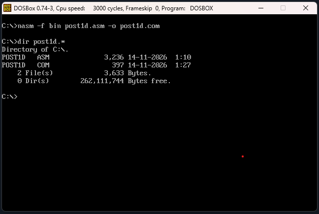 | 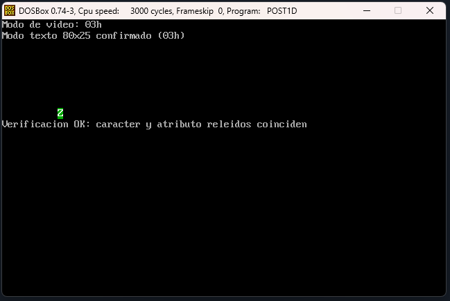 |
| P2 · CP1 `post2a` | 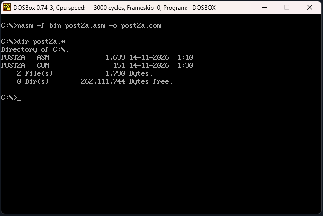 | 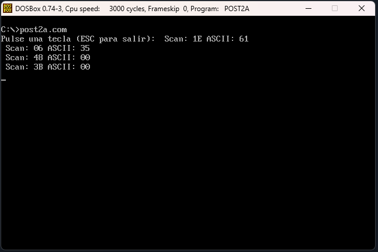 |
| P2 · CP2 `post2b` | 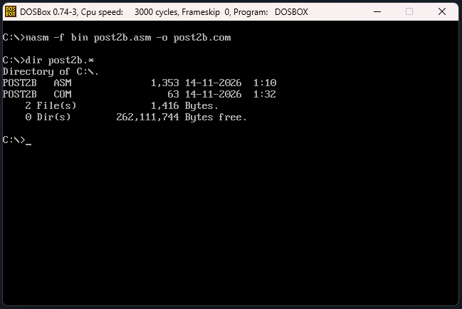 | 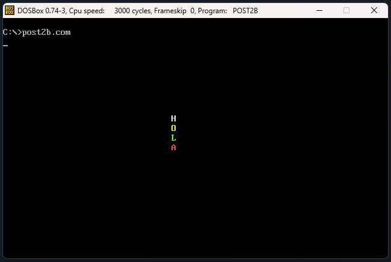 |
| P2 · CP3 `post2c` | 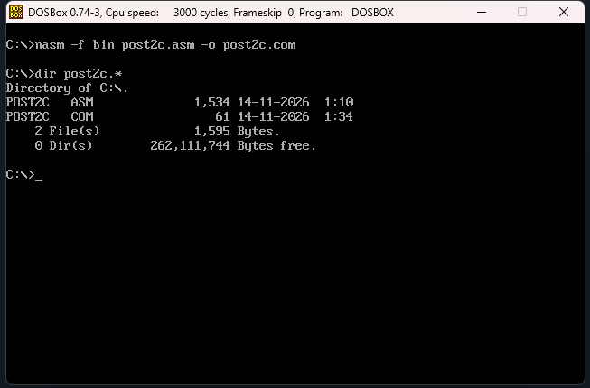 | 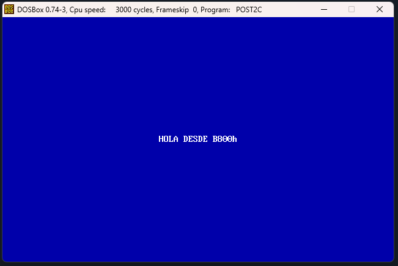 |
| P2 · CP4 `post2d` |  | 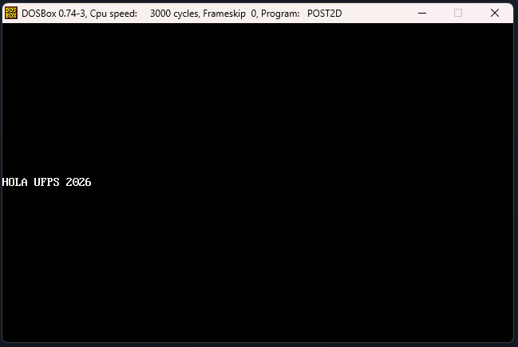 |
| P2 · CP5 `post2e` |  | 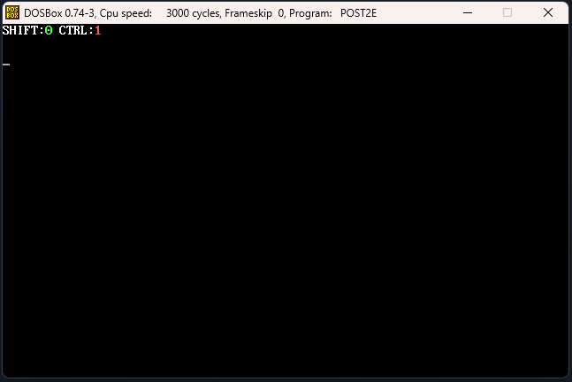 |

| Checkpoint de decisiones | Decisión 1 | Decisión 2 |
|---|---|---|
| P1 · CP5 | 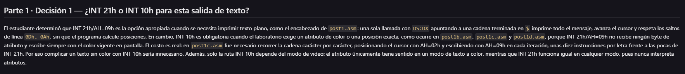 |  |
| P2 · CP6 |  | 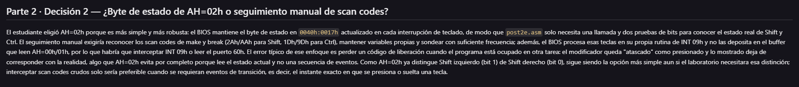 |

---

# Decisiones técnicas

## Parte 1 · Decisión 1 — ¿INT 21h o INT 10h para esta salida de texto?

El estudiante determinó que INT 21h/AH=09h es la opción apropiada cuando se necesita imprimir texto plano, como el encabezado de `post1.asm`: una sola llamada con `DS:DX` apuntando a una cadena terminada en `$` imprime todo el mensaje, avanza el cursor y respeta los saltos de línea `0Dh, 0Ah`, sin que el programa calcule posiciones. En cambio, INT 10h es obligatoria cuando el laboratorio exige un atributo de color o una posición exacta, como ocurre en `post1b.asm`, `post1c.asm` y `post1d.asm`, porque INT 21h/AH=09h no recibe ningún byte de atributo y escribe siempre con el color vigente en pantalla. El costo es real: en `post1c.asm` fue necesario recorrer la cadena carácter por carácter, posicionando el cursor con AH=02h y escribiendo con AH=09h en cada iteración, unas diez instrucciones por letra frente a las pocas de INT 21h. Por eso complicar un texto sin color con INT 10h sería innecesario. Además, solo la ruta INT 10h depende del modo de video: el atributo únicamente tiene sentido en un modo de texto a color, mientras que INT 21h funciona igual en cualquier modo, pues nunca interpreta atributos.

## Parte 1 · Decisión 2 — ¿Por qué verificar el modo de video y releer una celda en lugar de asumir su estado?

El estudiante concluyó que suponer un modo de video fijo es una hipótesis frágil. Si `post1b.asm` o `post1c.asm` se ejecutaran con un modo distinto de 03h, por ejemplo un modo gráfico o uno monocromo, el byte de atributo se interpretaría de otra forma, los colores saldrían incorrectos o la pantalla se corrompería, y el programa no daría ningún aviso. AH=0Fh es la forma correcta de comprobarlo porque pregunta al BIOS el modo realmente activo (`AL`), el número de columnas (`AH`) y la página (`BH`), en lugar de dejarlo cableado en el código. De igual modo, confiar en que lo escrito con AH=09h "debe estar ahí" deja sin detectar un error silencioso: releer la celda con AH=08h y comparar carácter y atributo confirma que la escritura fue efectiva, algo valioso en un editor de pantalla donde la consistencia visual importa. Frente al acceso directo a B800h de la Parte 2, AH=08h ofrece independencia del modo de video y no exige aritmética de segmento:offset, mientras que B800h es más rápido pero obliga a conocer de antemano el modo y el formato de la memoria de video.

## Parte 2 · Decisión 1 — ¿Lectura bloqueante con INT 16h o sondeo directo del puerto 60h?

El estudiante determinó que sería inviable reemplazar AH=02h por AH=00h dentro del bucle de `post2e.asm`, porque AH=00h bloquea la ejecución hasta que se pulsa una tecla: mientras no hubiera pulsaciones el bucle quedaría detenido y el reflejo de Shift y Ctrl dejaría de actualizarse, justamente cuando el objetivo es mostrar su estado de forma continua. Por eso el programa combina AH=02h, que consulta el byte de estado sin esperar, con AH=01h, que sondea el buffer sin consumirlo. Leer el puerto 60h con `IN AL, 60h` evitaría la sobrecarga de la interrupción del BIOS y daría mayor velocidad y control total, pero obligaría al programa a ocuparse de la controladora de interrupciones, a distinguir por sí mismo los make codes de los break codes y a lidiar con el conjunto de scan codes del teclado, tareas que INT 16h resuelve automáticamente. Para un laboratorio de aplicación en DOSBox, INT 16h es la opción apropiada; el acceso directo al puerto resulta necesario en un sistema operativo propio o en un controlador de teclado, donde no existe el BIOS como intermediario.

## Parte 2 · Decisión 2 — ¿Byte de estado de AH=02h o seguimiento manual de scan codes?

El estudiante eligió AH=02h porque es más simple y más robusta: el BIOS mantiene el byte de estado en `0040h:0017h` actualizado en cada interrupción de teclado, de modo que `post2e.asm` solo necesita una llamada y dos pruebas de bits para conocer el estado real de Shift y Ctrl. El seguimiento manual exigiría reconocer los scan codes de make y break (2Ah/AAh para Shift, 1Dh/9Dh para Ctrl), mantener variables propias y sondear con suficiente frecuencia; además, el BIOS procesa esas teclas en su propia rutina de INT 09h y no las deposita en el buffer que leen AH=00h/01h, por lo que habría que interceptar INT 09h o leer el puerto 60h. El error típico de ese enfoque es perder un código de liberación cuando el programa está ocupado en otra tarea: el modificador queda "atascado" como presionado y lo mostrado deja de corresponder con la realidad, algo que AH=02h evita por completo porque lee el estado actual y no una secuencia de eventos. Como AH=02h ya distingue Shift izquierdo (bit 1) de Shift derecho (bit 0), sigue siendo la opción más simple aun si el laboratorio necesitara esa distinción; interceptar scan codes crudos solo sería preferible cuando se requieran eventos de transición, es decir, el instante exacto en que se presiona o suelta una tecla.
